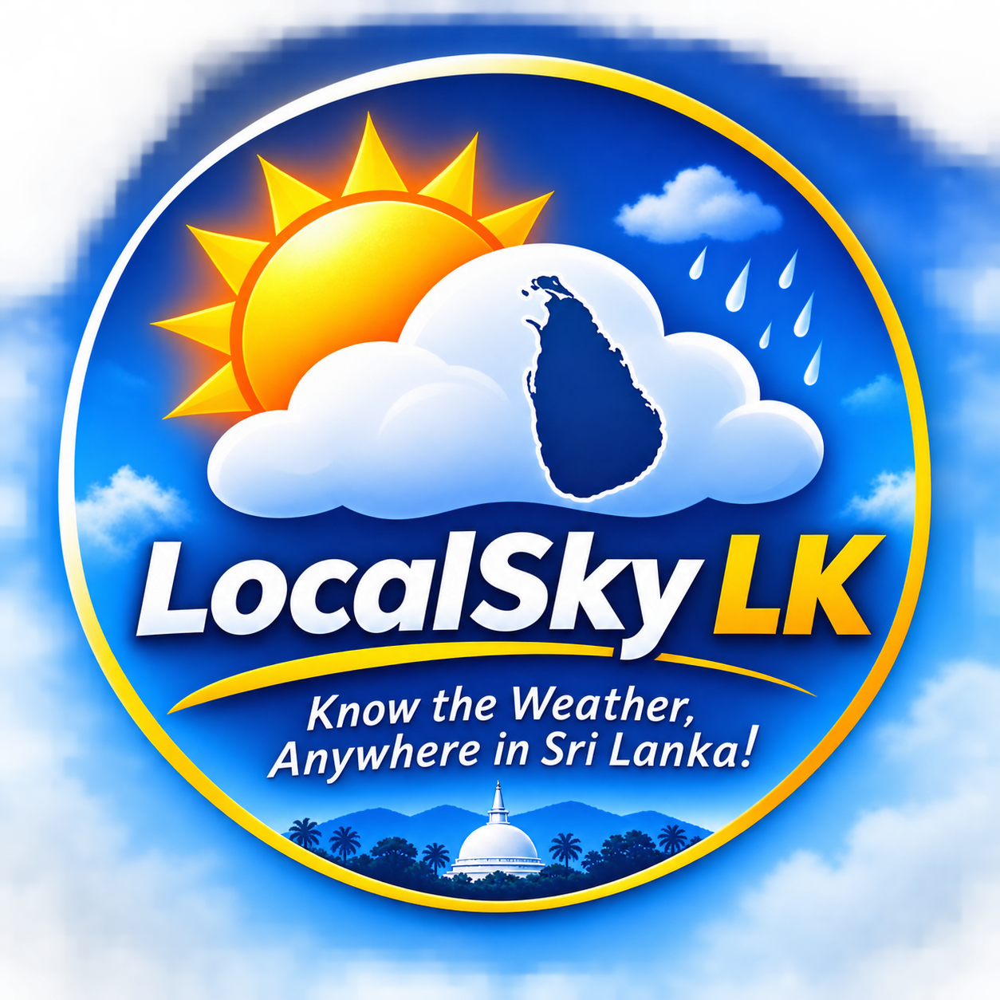
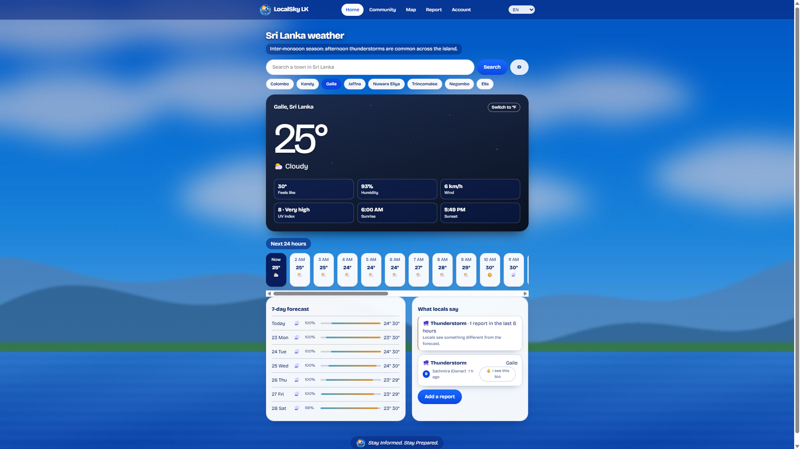
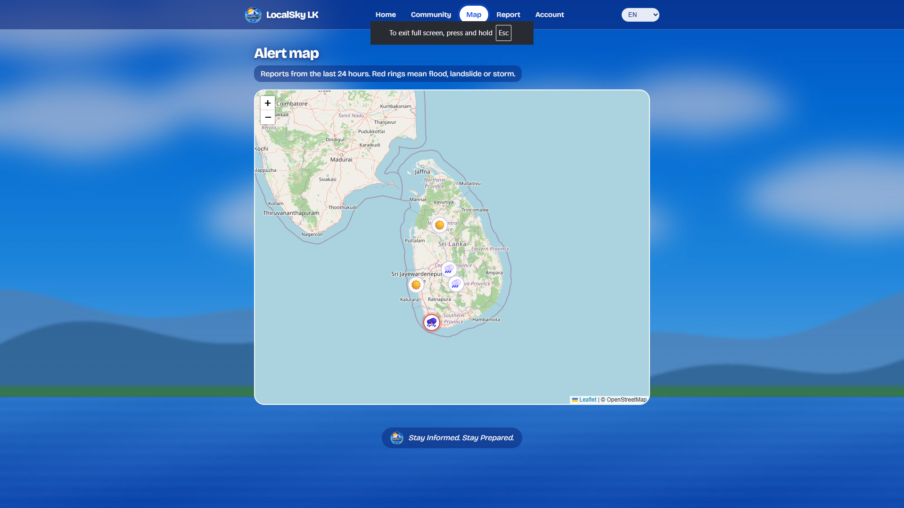
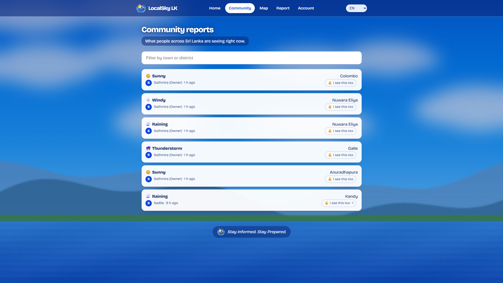
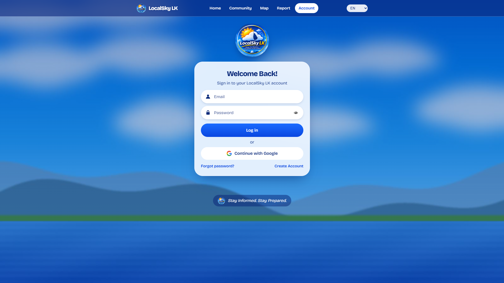
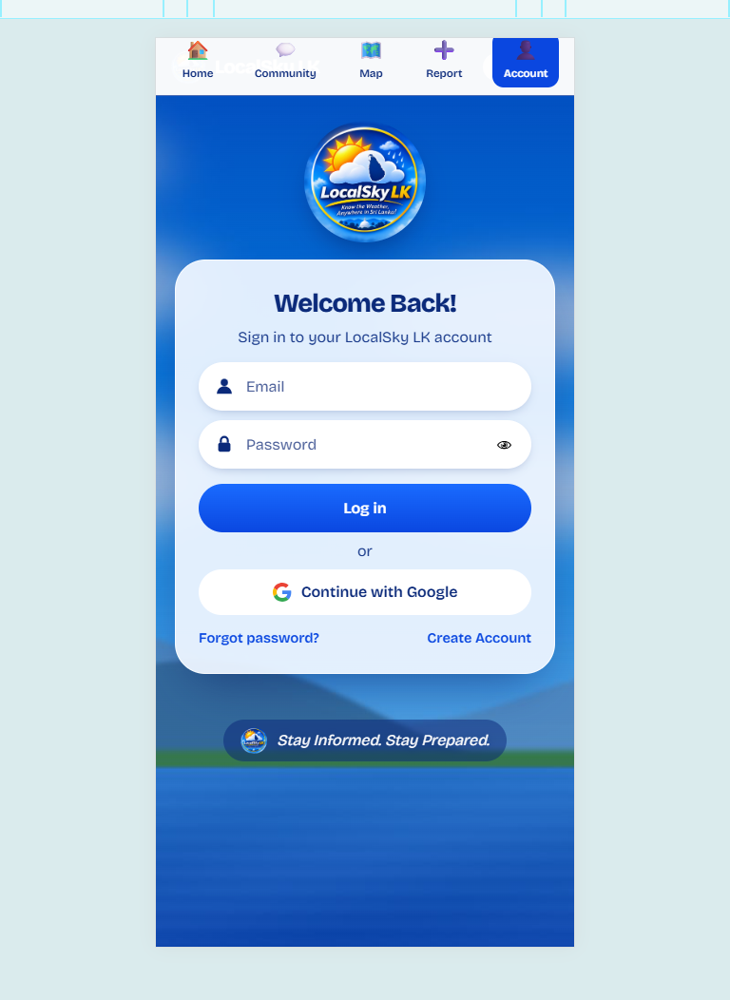

<p align="center">
  
</p>

<h1 align="center">LocalSky LK</h1>

<p align="center">
  <b>Know the weather, anywhere in Sri Lanka.</b><br>
  The live forecast, plus what people on the ground are actually seeing.
</p>

<p align="center">
  <a href="https://sathmira23.github.io/localsky"><b>▶ Live demo</b></a>
  &nbsp;·&nbsp;
  <a href="https://github.com/Sathmira23/localsky">Source code</a>
</p>

<p align="center">
  
  
  
  
  
</p>

---

A weather app built only for Sri Lanka. It shows the live forecast and, next to it, what people on the ground are reporting. If locals see something different from the forecast (heavy rain, flooding, a landslide risk), the app tells you.

## Features

- **Forecast** for any town in Sri Lanka: current weather, next 24 hours, 7 days, UV index, sunrise and sunset
- **Community reports**: signed-in users post what they see (sunny, raining, thunderstorm, flooding, landslide...) and others confirm with "I see this too"
- **Forecast vs locals**: a banner compares the forecast with recent reports for the same town
- **Alert map**: flood, landslide and storm reports from the last 24 hours on a map
- **Accounts**: email and password sign up, Google sign-in, password reset, profile with stats and a level badge
- **Three languages**: English, සිංහල, தமிழ்
- **Mobile friendly**, with a bottom tab bar on phones
- Sri Lanka only: search is limited to Sri Lankan places, and the GPS button snaps to the nearest district or town

## Screenshots

<p align="center">
  
  
</p>
<p align="center">
  
  
</p>
<p align="center">
  
</p>

## Built with

| Part | Tech |
|---|---|
| Frontend | HTML, CSS, vanilla JavaScript (single page, hash routing) |
| Forecast and search | [Open-Meteo](https://open-meteo.com/) Forecast and Geocoding APIs (no API key) |
| Login | Firebase Authentication |
| Database | Cloud Firestore (realtime updates) |
| Map | Leaflet and OpenStreetMap |
| Hosting | GitHub Pages |

## Run it locally

1. Clone the repo
2. Open the folder in VS Code and run `index.html` with the **Live Server** extension
3. Create your own Firebase project (Authentication with Email/Password, and Firestore) and replace the `firebaseConfig` values in `index.html`

## Firestore security rules

```
rules_version = '2';
service cloud.firestore {
  match /databases/{database}/documents {
    match /reports/{id} {
      allow read: if true;
      allow create: if request.auth != null
        && request.resource.data.uid == request.auth.uid
        && request.resource.data.note.size() <= 200;
      allow update: if request.auth != null
        && request.resource.data.diff(resource.data).affectedKeys().hasOnly(['confirms'])
        && request.resource.data.confirms.size() - resource.data.get('confirms', []).size() <= 1
        && resource.data.get('confirms', []).size() - request.resource.data.confirms.size() <= 1;
      allow delete: if request.auth != null
        && resource.data.uid == request.auth.uid;
    }
  }
}
```

Anyone can read reports. Only signed-in users can post, only the author can delete, and an update can only change the confirmations list.

## Project structure

```
index.html          the whole app (HTML, CSS, JS)
sky-bg.jpg          background image
logo.png            logo and favicon
icon-192.png        app icons
icon-512.png
apple-touch-icon.png
manifest.json       web app manifest
sw.js               service worker
screenshots/        images used in this README
```

## What I learned

- Calling REST APIs with `async` and `await`, and handling errors
- Firebase Authentication and realtime Firestore
- Writing security rules, so the database is protected on the server side
- Preventing XSS by escaping user text before rendering it
- Responsive design and a small i18n system without a framework

## Ideas for later

- Push alerts for floods and landslides
- Photo uploads on reports
- District level weather warnings

## Credits

Weather data by [Open-Meteo](https://open-meteo.com/). Map data by [OpenStreetMap](https://www.openstreetmap.org/copyright) contributors.

---

<p align="center">Built by <a href="https://github.com/Sathmira23">Sathmira</a> · Stay Informed. Stay Prepared. 🇱🇰</p>
